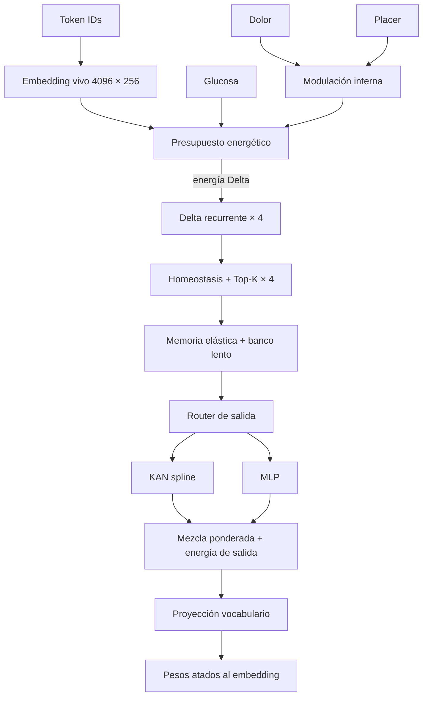

# Arquitectura actual de Lumen-Ronin
>
> **Corte:** 22 de noviembre de 2026 · código en `main`, commit `8701fac4`.
>
> Esta página describe el código real y la configuración del entrenamiento 61.000 → 66.000. Cuando el código base y el perfil de ejecución difieren, se indica expresamente.

## 1. Qué es Lumen

Lumen-Ronin es un modelo recurrente de lenguaje, CPU-first, que combina un estado asociativo Delta de bajo rango, regulación homeostática de actividad, un presupuesto energético aprendido, memoria rápida/lenta y una cabeza de salida con rutas KAN/MLP.

No es un Transformer renombrado. Tampoco es un cerebro digital ni una simulación biológica completa. Es una arquitectura de software que convierte hipótesis funcionales inspiradas en neurociencia en mecanismos explícitos, instrumentables y falsables.

El identificador de arquitectura serializado en los checkpoints es:

`ronin_lumen_v3_2_parallel_delta`

El modelo principal se implementa en [model/lumen.py](../model/lumen.py); la configuración base está en [model/config.py](../model/config.py).

## 2. Diagrama funcional



## 3. Parámetros estructurales y secuencia

| Componente | Configuración |
|---|---|
| Dimensión del modelo | 256 |
| Vocabulario configurado | 4.096 |
| Capas Delta | 4 |
| Rango de estado Delta | 64 |
| Refinamientos paralelos base | 6 en `CONFIG`; 2 en el perfil activo 61k→66k |
| Homeostasis | 4 órganos, uno después de cada Delta |
| Top-K | 16 en las dos primeras capas; 32 en las dos últimas |
| Batch del entrenamiento actual | 8 |
| Contexto del entrenamiento actual | 128 tokens |
| Seed | 42 |
| Embedding/salida | pesos compartidos (tied weights) |

El tokenizer y el corpus son artefactos congelados y verificados por hash. La dimensión del vocabulario del modelo no debe confundirse con el número de documentos del corpus.

## 4. Los órganos y sus responsabilidades

### 4.1 Embedding vivo

`VivoEmbedding` transforma IDs en vectores de 256 dimensiones. Registra el uso de cada ID y puede proponer filas sin uso para una poda posterior. Esa poda es una propuesta no destructiva: el tokenizer congelado no se modifica en caliente.

La matriz de salida comparte los mismos pesos que el embedding; no se mantiene una segunda tabla independiente de logits.

### 4.2 Presupuesto energético y glucosa

`Presupuesto` aprende una distribución softmax sobre tres destinos:

- estado Delta;
- memoria;
- cabeza de salida.

La glucosa es una reserva separada que escala la energía total disponible. En la configuración implementada, un control de loss que mejora al menos un 0,5 % añade 0,02 de reserva, con un máximo de 0,25. Si no hay mejora suficiente, la reserva decae multiplicativamente por 0,98.

La glucosa no cambia directamente el learning rate ni los momentos de AdamW. Decide cuánto presupuesto interno hay para las rutas del modelo.

### 4.3 Estado Delta: memoria asociativa recurrente

Cada una de las cuatro capas `EstadoDelta` mantiene un estado de bajo rango (64 × 256 por elemento de batch). Proyecta claves, valores y consultas; calcula error de predicción/sorpresa; y utiliza esa señal para decidir si escribe, con qué intensidad y cuánto decae el estado.

La ruta paralela actual organiza las interacciones causales mediante productos matriciales por lotes y refinamientos de punto fijo. **No debe describirse como una identidad matemática exacta de la recurrencia no lineal:** el resultado depende del número de refinamientos y debe auditarse frente a la ruta secuencial de referencia.

- Valor base en código: 6 refinamientos.
- Valor del perfil activo de 61k→66k: 2 refinamientos.
- `delta_pre_normalize=false` en el perfil medido.
- Las cuatro capas siguen activas; no se desactiva ninguna para ganar velocidad.

La decisión de pasar a dos refinamientos se tomó por mediciones emparejadas de throughput y pérdida. No implica que dos sea universalmente óptimo.

### 4.4 Homeostasis y Top-K

Cada capa Delta tiene un órgano Homeostasis asociado. Mantiene medias móviles de actividad, mide qué unidades sobreviven realmente al gate ReLU + Top-K y ajusta un bias para regular la actividad efectiva.

El Top-K restringe la actualización homeostática; la ruta residual conserva el flujo de información. Esta distinción es importante: una versión temprana podía sustituir la representación por la salida dispersa y colapsar las capas superiores. La ruta residual de V3.1 corrigió ese problema.

En el perfil actual:

- K=16 en capas 0 y 1.
- K=32 en capas 2 y 3.
- `homeostasis_fused_scatter=false`: el camino fusionado se probó y no ganó throughput en el benchmark de ejecución real.

### 4.5 Memoria elástica y memoria lenta

`MemoriaElastica` combina dos escalas:

- **Ruta elástica:** un MLP de 256 → 64 → 256, con gradiente limitado para que su actualización no domine el aprendizaje.
- **Banco lento:** 128 slots de 256 dimensiones. Registra activaciones asociadas a sorpresa alta, recupera por similitud y mantiene estadísticas de uso. Cuando está lleno, puede reemplazar el slot menos utilizado.

Los umbrales por defecto son sorpresa menor que 0,3 para la ruta elástica y mayor que 0,8 para registrar una memoria lenta. La memoria se conserva en buffers del checkpoint. En evaluación, la recuperación no debe mutar el banco.

La existencia del banco no demuestra que ya se haya consolidado conocimiento útil: para eso hay que medir ocupación, recuperación, retención e interferencia.

### 4.6 Cabeza de salida: router, KAN y MLP

La salida contiene dos rutas:

- Una rama KAN-like basada en 32 splines con 8 puntos cada una.
- Una rama MLP de dimensión oculta 512.

Un router aprendido produce dos pesos y mezcla las salidas. El presupuesto energético regula la contribución final de la cabeza. La proyección al vocabulario utiliza los pesos atados al embedding.

### 4.7 Objetivo de entrenamiento

La pérdida actual combina:

- cross-entropy del siguiente token;
- predicción latente JEPA;
- diversidad de activaciones;
- regularización del router;
- penalización de repetición.

La ponderación implementada en `train/loss.py` es:

```python
total = (
    token_loss
    + 0.3 * latent_loss
    + 0.01 * diversity_loss
    + 0.01 * router_loss
    + 0.05 * repetition_loss
)
```

La complejidad tipo energía libre solo se añade cuando se habilita expresamente la extensión correspondiente.

## 5. Glucosa, dolor y placer: tres señales distintas

Los órganos afectivos no son parámetros narrativos ni emociones conscientes. Son reguladores numéricos independientes, con buffers persistentes y respuestas acotadas.

| Órgano | Señal que observa | Función |
|---|---|---|
| Glucosa | Mejora de loss de comprobación | Repone reserva energética interna |
| Dolor | Regresión de loss frente a su EMA | Señal protectora; modula plasticidad y gate |
| Placer | Mejora de loss frente a su EMA | Refuerzo moderado; modula plasticidad y gate |

Dolor y placer mantienen EMAs separadas. No se calculan a partir del holdout. En la línea 11k→16k se integraron como canales independientes y en los entrenamientos posteriores se conservaron como órganos activos.

### Perfil seleccionado para el bloque 61k→66k

El workflow [45061486739](https://github.com/orbitalronin94/WISE-RONIN/actions/runs/45061486739) aplica:

| Parámetro | Valor |
|---|---:|
| Dolor: response | 0,30 |
| Dolor: decay | 0,55 |
| Placer: response | 0,75 |
| Glucose/pain budget gain | 0,10 |
| Pleasure budget gain | 0,1125 |
| Refinamientos Delta paralelos | 2 |

Todos los órganos permanecen activos. Dolor y placer modulan el multiplicador energético interno; no modifican el LR ni los momentos del optimizador. Este perfil es la configuración del bloque en curso, no una constante universal ni una conclusión definitiva sobre qué intensidad es mejor.

## 6. Extensiones presentes en el código, pero no activas en el bloque actual

### Dual-state ZE / LC-NE

`model/ze.py` implementa una extensión opcional con dos estados, conflicto entre rutas, localización y un operador de borrado acotado. Solo se construye cuando se activa `--v32-ze`. El workflow 61k→66k no pasa esa bandera; por tanto, no debe describirse como parte activa de ese entrenamiento.

### Sueño y replay

`train/sleep.py` contiene una rutina de replay offline sobre registros de memoria lenta. El workflow 61k→66k pasa `--no-sleep`; el sueño está implementado, pero desactivado en ese bloque. Los pilotos anteriores mostraron que puede omitirse cuando no hay registros lentos consolidados.

Esta distinción entre código disponible y código efectivamente ejecutado es esencial para que el README no atribuya al checkpoint mecanismos que no utilizó.

## 7. Perfil de ejecución CPU actual

El perfil del bloque activo:

- 4 hilos intra-op y 2 inter-op;
- MKLDNN activado;
- AdamW `foreach=false`;
- afinidad CPU fijada a los cores disponibles;
- Delta pre-normalization desactivada;
- scatter fusionado de Homeostasis desactivado;
- batch 8 y longitud 128;
- corpus y tokenizer preprocesados y compartidos.

El entrenamiento se ejecuta en GitHub Actions sobre CPU. La prioridad es optimizar el coste del bucle recurrente y su backward sin eliminar órganos ni cambiar silenciosamente la función del modelo.

## 8. Transformer de control

El baseline es un decoder Transformer de cuatro capas, dimensión 192, cuatro cabezas, feed-forward 576 y embeddings atados. Su checkpoint registra 2.295.168 parámetros.

No es el modelo principal. Es un control necesario para responder una pregunta experimental: con el mismo corpus, tokenizer, seed, batch, contexto y presupuesto de pasos, ¿qué diferencias aparecen entre la ruta recurrente con órganos y una arquitectura Transformer convencional?

La comparación no es perfectamente neutral si las funciones objetivo difieren; por eso los resultados de loss, NLL y accuracy deben presentarse con sus definiciones y no reducirse a una sola cifra.

## 9. Datos y protocolo actual

El corpus español v1 utilizado por los entrenamientos emparejados contiene:

| Split | Registros |
|---|---:|
| Entrenamiento | 70.105 |
| Validación | 1.413 |
| Holdout congelado | 2.431 |
| Total deduplicado | 73.949 |

Procede de cuatro fuentes de entrenamiento con filtrado por componentes y licencia. El holdout está separado: 1.931 preguntas SIQA-es y 500 OpenBookQA-es. La evaluación no actualiza parámetros ni alimenta glucosa, dolor o placer.

Los hashes y procedencia se documentan en [data/README.md](../data/README.md); el historial de resultados está en [CRONICA_EXPERIMENTAL_ES.md](CRONICA_EXPERIMENTAL_ES.md).

## 10. Límites y obligaciones de evidencia

- Una analogía biológica no demuestra equivalencia funcional con un organismo.
- Una loss menor no demuestra mejor generación ni generalización.
- Un microbenchmark de 100 pasos no es un holdout.
- Un perfil que gana velocidad debe conservar paridad, estabilidad y calidad.
- Una ejecución marcada como fallida puede haber guardado checkpoints; deben verificarse y evaluarse por separado.
- Las diferencias de accuracy deben acompañarse de NLL y, cuando corresponda, de análisis emparejado.
- No se debe afirmar que un órgano estuvo activo si el workflow lo deshabilitó.

## Código de referencia

| Responsabilidad | Archivo |
|---|---|
| Modelo integrado | [model/lumen.py](../model/lumen.py) |
| Configuración base | [model/config.py](../model/config.py) |
| Estado Delta | [model/delta_state.py](../model/delta_state.py) |
| Embedding | [model/embedding.py](../model/embedding.py) |
| Energía/glucosa | [model/energy.py](../model/energy.py) |
| Homeostasis | [model/homeostasis.py](../model/homeostasis.py) |
| Memoria | [model/memory.py](../model/memory.py) |
| Dolor | [model/pain.py](../model/pain.py) |
| Placer | [model/pleasure.py](../model/pleasure.py) |
| Cabezas KAN/MLP | [model/heads.py](../model/heads.py) |
| Extensión ZE | [model/ze.py](../model/ze.py) |
| Pérdidas | [train/loss.py](../train/loss.py) |
| Sueño/replay | [train/sleep.py](../train/sleep.py) |
| Entrenador/checkpoints | [train/train.py](../train/train.py) |
| Transformer de control | [train/transformer_baseline.py](../train/transformer_baseline.py) |
